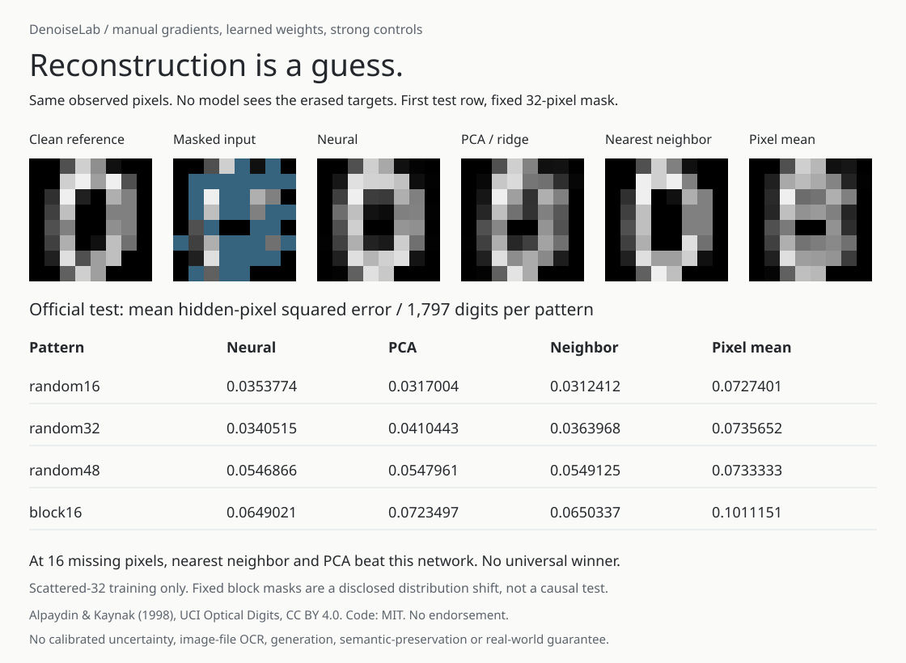

# DenoiseLab

DenoiseLab reconstructs hidden pixels in small UCI digit images, then checks
how the predictions change when visible values are edited. The network uses
manual NumPy backpropagation; an independent scalar JavaScript implementation
runs in the browser. Everything runs offline, without a model API or pretrained
weights.

The measured results depend on the mask. On the original UCI test set at **16
scattered missing pixels**, observed-pixel nearest neighbor and PCA both beat
this neural network. At **32 missing pixels**, the network has lower measured
MSE than those controls. At 48 missing pixels, the three are close. None of
these fixed-seed measurements is a universal ranking or an uncertainty bound.



## Choose an inspector

| Question | Page | Scope |
| --- | --- | --- |
| What is reconstructed from this mask? | [Reconstruction](https://midya8.github.io/denoiselab/) | Neural, PCA, neighbor and mean predictions |
| How does a fixed-mask edit change the output? | [Local response](https://midya8.github.io/denoiselab/response.html) | Finite edits, local Jacobians and residuals |
| Where does the nearest neighbor switch along one coordinate? | [One-pixel path](https://midya8.github.io/denoiselab/path.html) | Exact rational intervals and endpoint ties |
| Which neighbor wins on a two-coordinate slice? | [Two-pixel cells](https://midya8.github.io/denoiselab/plane.html) | Exact area, segment, point and empty cells |

The later inspectors examine the original fits. They do not improve the held-out
scores or turn a fixed coordinate slice into a general robustness guarantee.

## Reconstruction inspector

Open the [live reconstruction inspector](https://midya8.github.io/denoiselab/) or `docs/index.html` locally. It runs the learned network, an observed-pixel
PCA ridge solve, observed-pixel nearest neighbor over all 3,062 fitting rows,
and the fitting pixel mean. It does not replay frozen predictions when you
change the mask: toggle arbitrary pixels, use keyboard controls, hide all or
reveal all. Exact input/mask/prediction JSON can be copied or downloaded.

No accounts, uploads, analytics, external model calls or inference server.
Models and public fitting examples are bundled. The first ten original test
rows are chosen by index, not successful reconstructions. These tiny 8-by-8
block counts are not MNIST, raw image-file OCR or a production restoration tool.

## Measured official test audit

Mean squared error **only on missing pixels**, averaged across all 1,797
original test digits. Pixel units are normalized from [0,16] to [0,1]. All
methods copy visible pixels unchanged; scoring all pixels would dilute the
error by the missing fraction.

| Pattern | Neural | PCA ridge | Neighbor | Pixel mean |
|---|---:|---:|---:|---:|
| 16 scattered pixels | 0.0353774 | 0.0317004 | 0.0312412 | 0.0727401 |
| 32 scattered pixels | 0.0340515 | 0.0410443 | 0.0363968 | 0.0735652 |
| 48 scattered pixels | 0.0546866 | 0.0547961 | 0.0549125 | 0.0733333 |
| 4-by-4 block / 16 pixels | 0.0649021 | 0.0723497 | 0.0650337 | 0.1011151 |

The training corruption hides exactly 32 randomly selected pixels per image,
refreshed on every presentation. All four evaluation patterns were fixed before
the test loader ran. Different counts and blocks are disclosed shifts, not
post-test tuning. One seed and one mask per image/case; no repeated-sample
confidence interval, robust recovery certificate or causal geometry claim.

## Models and protocol

- Official UCI 3,823 training / 1,797 test split stays intact. A deterministic
  class-stratified feature-hash split yields 3,062 fitting / 761 validation rows.
  No exact feature duplicates cross partitions; near duplicates are not excluded.
- Network input: 64 erased values plus 64 missing flags. Tanh widths 64, 16,
  64, then 64 sigmoid outputs. **14,544 learned parameters**. All derivatives
  are written out, including hidden-only MSE and weight L2. Adam is explicit.
- Epoch candidates 10, 30, 60; minimum validation hidden-pixel MSE selects 60.
  Validation error falls from 0.1797185 at initialization to 0.0320862.
- PCA fits mean/SVD basis using only fitting rows. Rank 8/16/32 and ridge
  .001/.01/.1/1 are selected on the same validation masks. Rank 16, ridge .1
  wins, also the bottleneck-rank-matched control. Inference solves coefficients
  from **observed coordinates only**, with ridge and output clipping. It is not
  a deliberately weak zero-filled orthogonal projection.
- Nearest neighbor uses squared error on visible pixels only, lowest fitting
  index on ties. Labels are used for the split, never fitting or prediction.
- Selected models, complete selection history, immutable evaluation plan,
  original source hashes, every per-image test score and first-ten predictions
  are saved as finite JSON. No pickle.

[METHOD.md](METHOD.md) gives equations, derivatives, seeds, provenance,
floating-point scope and limits. The denoising objective follows established
Vincent et al. work, not a new algorithm. No source experiment is claimed as
reproduced.

## Run offline

Python 3.10+, NumPy 2.2.6. No other runtime dependency.

```sh
pip install -e .
python -m denoiselab demo > /tmp/denoise-report.json
python -m denoiselab train --output /tmp/denoise-refit
python -m denoiselab evaluate --output /tmp/denoise-refit
python -m denoiselab predict --model denoiselab/artifacts/network.json --input examples/predict.json
OPENBLAS_NUM_THREADS=1 OMP_NUM_THREADS=1 python -m unittest discover -s tests -v
python examples/export_browser.py --check
python examples/render_audit.py --check
node --test tests/*.cjs
bash examples/demo.sh
```

`demo` reads the full saved report. `train` never loads test rows. `evaluate`
checks selected model/protocol/plan hashes before loading test data. `predict`
erases hidden positions before inference even if the supplied array contains
target values. The CLI exits 2 for invalid JSON or inputs.

## Verification

**52 Python tests** include 200 full-parameter finite differences against a
separate objective, a separate augmented least-squares PCA solve, nearest/tie
controls, exact data hashes and no duplicate features, full refit with a test
loader prohibition, full test re-evaluation, validation-only selection,
tampering refusal, CLI paths, SVG pixels/values and complete report metadata.

**Fourteen Node/real-Chrome tests** compare independent JavaScript inference with
Python on all 40 public test/mask examples, verify hidden-target erasure and
visible-pixel identity, check a tiny analytic ridge solve, and exercise actual
browser masks, keyboard controls, copy denial/success, downloads and responsive
320/390/1280 layouts. The phone audit table stacks into labeled cards; it does
not hide core values behind horizontal scrolling.

CI also builds a wheel and runs all ten modules and nine CLI commands from
outside the checkout, refitting and evaluating the installed package. Floating
training is checked with explicit tolerances, not claimed bitwise portable
across BLAS implementations. Exported files are exact from committed artifacts.

## Attribution and limits

Data: Alpaydin, E. & Kaynak, C. (1998), [Optical Recognition of Handwritten
Digits](https://archive.ics.uci.edu/dataset/80/optical+recognition+of+handwritten+digits),
UCI, DOI [10.24432/C50P49](https://doi.org/10.24432/C50P49), CC BY 4.0.
Original numeric files and manifest are retained from the same verified source
archive used by DigitLab. Rendered inputs and reconstructions are adaptations;
no endorsement is implied. Code is MIT; data terms are separate in
[the data notice](denoiselab/data/LICENSE.md).

One historical dataset, small images, one model/seed/budget, fixed artificial
missingness, no individual writer IDs. Masked reconstruction error does not
establish semantic preservation, calibrated uncertainty, image generation,
clinical restoration or behavior on naturally missing observations. This is a
standalone reconstruction experiment, not DigitLab's classifier/attack study
or LatentLab's synthetic variational density model.

## Fixed-mask input response

The [response inspector](https://midya8.github.io/denoiselab/response.html) compares actual finite observed-pixel edits with hand-derived local neural and PCA responses. Full 64×64 Jacobians expose hidden-input erasure and visible-output identity. Shared-scale signed heatmaps retain every scalar derivative. Original/edited/tangent images and complete residuals stay separate; displayed images clamp grayscale, but JSON preserves unbounded tangent values.

PCA solves its observed-only ridge response and marks nonconstant clipping-boundary rows null. Nearest-neighbor retrieval is treated as a possible discontinuous switch, not given a made-up global gradient. Its old/new original fitting-row indices and a clearly labeled frozen-neighbor control remain visible. Hidden targets, labels, mask derivatives and retraining are excluded. The original fits, holdout scores, model selection and stronger control results are unchanged.

The v0.2 extension added eight Python and four Node/Chrome tests for independent finite differences, augmented least squares, clipping and neighbor-switch controls, 120 full cross-language responses (983,040 Jacobian entries), 480 browser views and 8,192 actual heatmap pixel checks. At v0.2, installed-wheel reproduction covered eight modules and five commands, including the original full refit and evaluation. [RESPONSE.md](RESPONSE.md) records formulas, source scope and numerical limits.

```sh
python -m denoiselab response --input examples/response.json
```

Local response is not causal importance, finite-edit correctness, a certified stability radius, uncertainty or improved reconstruction accuracy. Masks are discrete and fixed per response query.

## One-pixel retrieval switches

The [exact edit-path inspector](https://midya8.github.io/denoiselab/path.html) shows every nearest-neighbor interval and every endpoint tie while one observed value moves over [0,1]. Quantized original inputs make source coefficients integer; a common quadratic cancels, leaving at most 17 candidate slopes. Fraction/BigInt lower envelopes retain coincident rows and point-only tie winners. A separate verifier recomputes the intended source and checks all-row endpoint dominance without regenerating the hull.

Exact rational query buttons, complete tie lists, approximate-only image rendering and full JSON keep the scope visible: one observed coordinate, fixed other observed values and mask. This is not a simultaneous-input robustness radius or a guarantee of binary64 tie agreement. Original models, stronger controls and accuracy scores are unchanged.

At v0.3, nine new Python and three Node/Chrome tests brought the suite to 44/eleven. Independent all-pair enumeration checks 5,344 rational queries; 40 full cross-language path proofs and 160 source-grounded queries cover all original public cases; Chrome inspects 30,720 actual canvas colors. Nine-module/seven-command installed reproduction includes both path creation and independent-source verification. [PATH.md](PATH.md) gives the derivation, proof, exact arithmetic and source limits.

```sh
python -m denoiselab edit-path --input examples/edit-path.json
```

## Two-pixel exact minimum cells

[Move two observed values together](https://midya8.github.io/denoiselab/plane.html). Closed exact rational power cells include area, segment-only, point-only and explicitly proved empty regions. Shared boundaries use full all-row tie queries, not a polygon's interior representative. Fraction/BigInt witnesses retain every source coefficient. A source-matched verifier checks supporting halfplanes, maximal lower-dimensional cells and nonnegative infeasibility combinations without rerunning clipping.

The v0.4 extension added eight Python and three Node/Chrome tests, bringing the current suite to 52/fourteen. Independent boundary-pair enumeration checks 238 small-source cells and 2,110 queries. Forty full-source maps agree across languages; Chrome checks 160 queries and 30,720 canvas colors. Ten-module/nine-command installed reproduction retains the original full refit/evaluation. [PLANE.md](PLANE.md) records the geometry, separate verifier, source ledger and limits. Fixed two-coordinate slice only, not general robustness, plausible recourse, better accuracy or binary64 tie equivalence. Original models, data and held-out scores remain unchanged.
